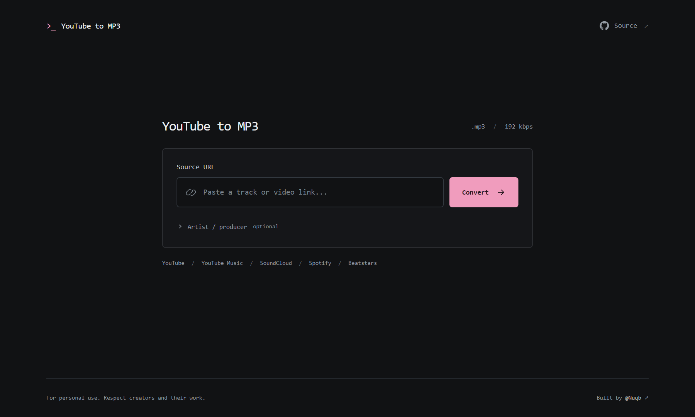
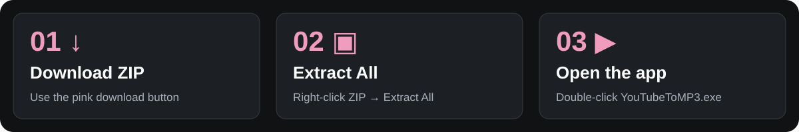

<div align="center">

# YouTube to MP3

**Paste a link. Convert. Save your MP3.**

[](https://github.com/Nuqb/YouTubeToMP3/releases/latest/download/YouTubeToMP3-Windows-x64.zip)

Windows 10/11 · 64-bit · Internet connection required



</div>

## Start here



1. **[Download the Windows ZIP](https://github.com/Nuqb/YouTubeToMP3/releases/latest/download/YouTubeToMP3-Windows-x64.zip).**
2. Right-click it → **Extract All** → **Extract**.
3. Open the extracted **YouTubeToMP3** folder → double-click **YouTubeToMP3.exe**.

The converter opens in your browser. Keep the small launcher window open while using it; close that window to stop the app. Use **Open converter** to reopen the browser tab.

> Keep the whole extracted folder together, including `_internal`. You can move the folder wherever you like. No installer or administrator access is needed.

## Make an MP3

**🔗 Paste your link → ✨ Click Convert → ↓ Download .mp3**

Your browser saves the file in its usual download location. Click **Download .mp3** promptly: converted files expire after **30 seconds**.

YouTube · YouTube Music · SoundCloud · Spotify · Beatstars

Spotify and Beatstars links search YouTube for a matching track; results can differ from the original. The optional **Artist / producer** field helps with Beatstars matches. Output is MP3 at 192 kbps.

<details>
<summary><strong>Need help?</strong></summary>

- **Windows shows an unknown publisher:** this release is unsigned. Check that your download came from [this repository's Releases page](https://github.com/Nuqb/YouTubeToMP3/releases). Only run it if you trust it; do not disable antivirus protection.
- **Nothing opens / a file is missing:** extract the entire ZIP first. Launch the executable inside the extracted folder, with `_internal` beside it.
- **Closed the browser tab?** Click **Open converter** in the launcher.
- **Download expired?** Convert the link again and save the MP3 within 30 seconds.
- **A link fails?** Try the newest release and a public YouTube link. Private, age-restricted, subscription-only content and platform blocks can prevent conversion. Signing into your browser does not sign the app into those services.
- **Mac or Linux?** The downloadable executable is currently for Windows x64. Use the developer instructions below to run from source.
- **Still stuck?** [Open an issue](https://github.com/Nuqb/YouTubeToMP3/issues) with the error and Windows version. Startup logs are at `%LOCALAPPDATA%\YouTubeToMP3\app.log`; review logs before sharing them.

</details>

The app runs on your computer and contacts source platforms to fetch content. Only download content you own or have permission to download, and respect platform terms.

---

## For developers

Python / Flask backend, yt-dlp + FFmpeg conversion, vanilla HTML/CSS/JavaScript frontend. The desktop launcher uses Tkinter and Waitress, binds to `127.0.0.1`, and chooses a free port automatically.

### Run from source

Use **Python 3.12** with Tkinter, **FFmpeg / FFprobe**, and **Deno 2.5+** on your PATH. Install FFmpeg from [its download page](https://ffmpeg.org/download.html) and Deno from [its installation guide](https://docs.deno.com/runtime/getting_started/installation/).

```bash
git clone https://github.com/Nuqb/YouTubeToMP3.git
cd YouTubeToMP3
python -m venv .venv
```

Activate on Windows: `.venv\Scripts\activate`

Activate on macOS/Linux: `source .venv/bin/activate`

```bash
python -m pip install -r requirements.txt
python desktop.py
```

For a terminal-only server, use `python desktop.py --headless --port 5000`, then open `http://127.0.0.1:5000`. `python app.py` also starts the Flask development server locally on port 5000; debugging is off by default. These local entry points are not configured for public hosting.

### Build the Windows download

Build on 64-bit Windows with Python 3.12:

```powershell
python -m pip install -r requirements-build.txt
python tools/build_release.py
python tools/smoke_release.py
```

The builder downloads fixed FFmpeg and Deno versions from their official GitHub releases, verifies SHA-256 digests, and bundles the UI, Python runtime, yt-dlp/EJS, and helper binaries with PyInstaller. Outputs:

- `dist/YouTubeToMP3-Windows-x64.zip` — the entire portable app.
- `dist/SHA256SUMS.txt` — download checksum.
- Inside the ZIP: `START-HERE.txt`, third-party notices/licenses, and `build-info.json` with exact dependency versions.

The executable is unsigned. A Windows build must be produced on Windows. See [third-party notices](docs/THIRD-PARTY-NOTICES.md) for bundled component licensing and source links.

### Release process

The [Windows release workflow](.github/workflows/release.yml) runs on version tags (`v*`) or manually. It builds and smoke-tests the portable download, then creates a draft GitHub release for version tags. Publish that draft to make the download available to users.

For a local release, build and test first, commit the intended source, create a version tag, and attach the ZIP and checksum using GitHub Releases. Keep the asset name `YouTubeToMP3-Windows-x64.zip` so the download button above continues to work.

### Checks and limitations

`python tools/smoke_release.py` extracts the ZIP into a path containing spaces and launches the frozen executable from a different working directory. It verifies page/assets, invalid-input handling, a real MP3 conversion/download using a local test audio server, and bundled FFmpeg, FFprobe, and Deno. It does not require or guarantee access to third-party platforms.

The root `test_*.py` files are manual network diagnostics for particular Spotify/Beatstars links, not an offline unit test suite. Platform behavior can change; update yt-dlp and publish a fresh executable when necessary. Converted files are temporary and are also removed when the app exits normally.

### Contributing

Bug reports, documentation, and pull requests are welcome. See [CONTRIBUTING.md](CONTRIBUTING.md) for setup, checks, and how to submit a change.

### License

This project's code and documentation are available under the [MIT License](LICENSE).
You may use, modify, and redistribute them, including commercially, while keeping
the copyright and license notice. The software comes without warranty.

Bundled third-party tools retain their own licenses, including the GPL v3 FFmpeg
build. See [third-party notices](docs/THIRD-PARTY-NOTICES.md) and the licenses
included in the Windows download.
